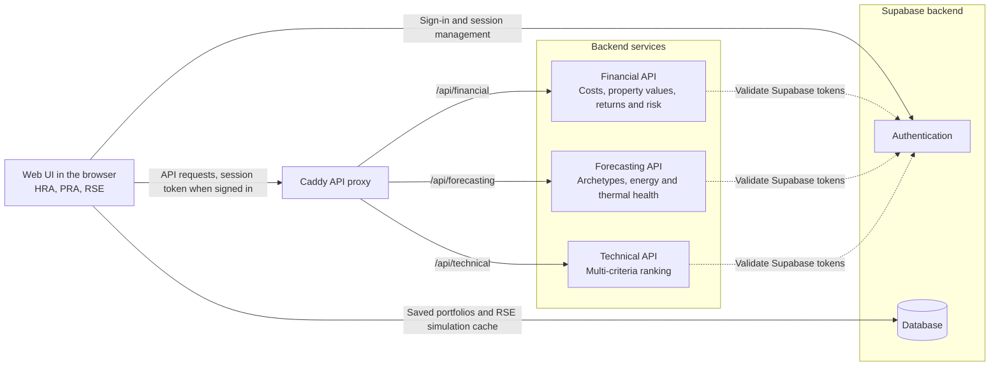
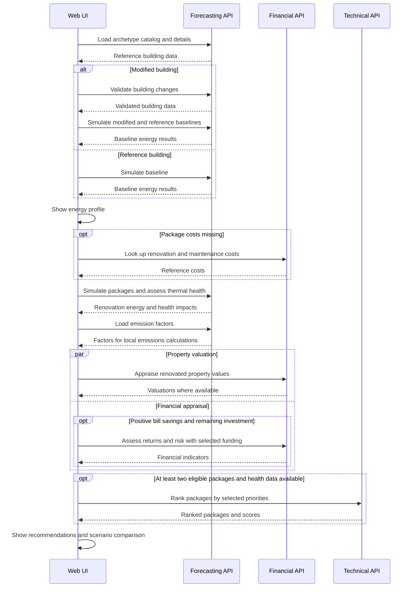
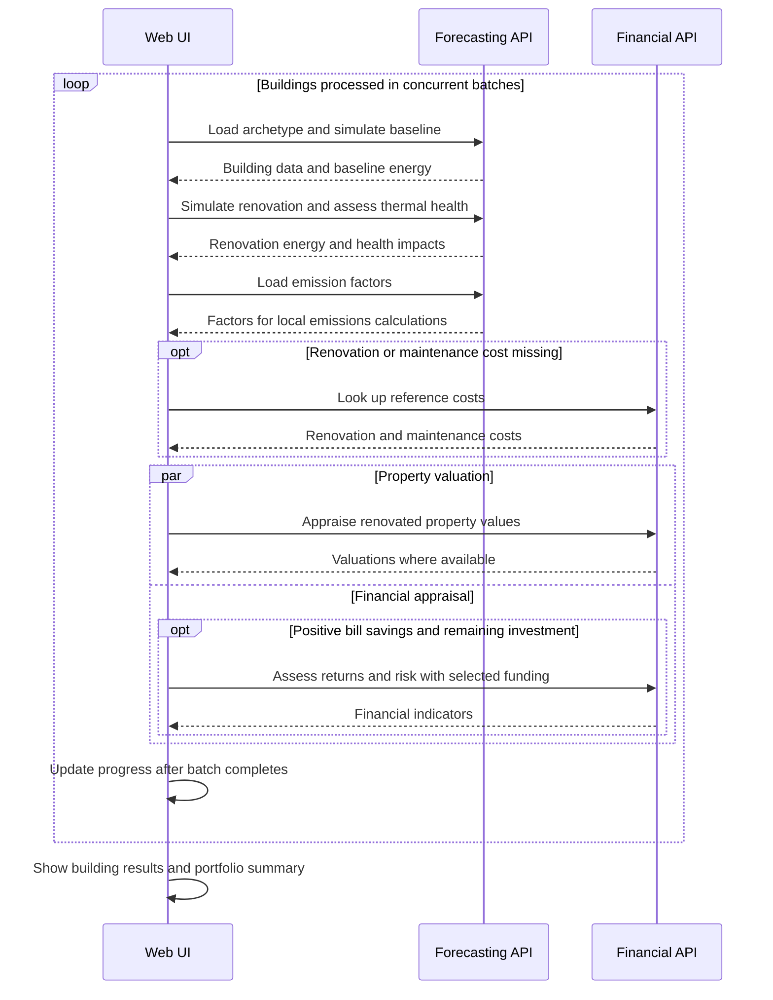
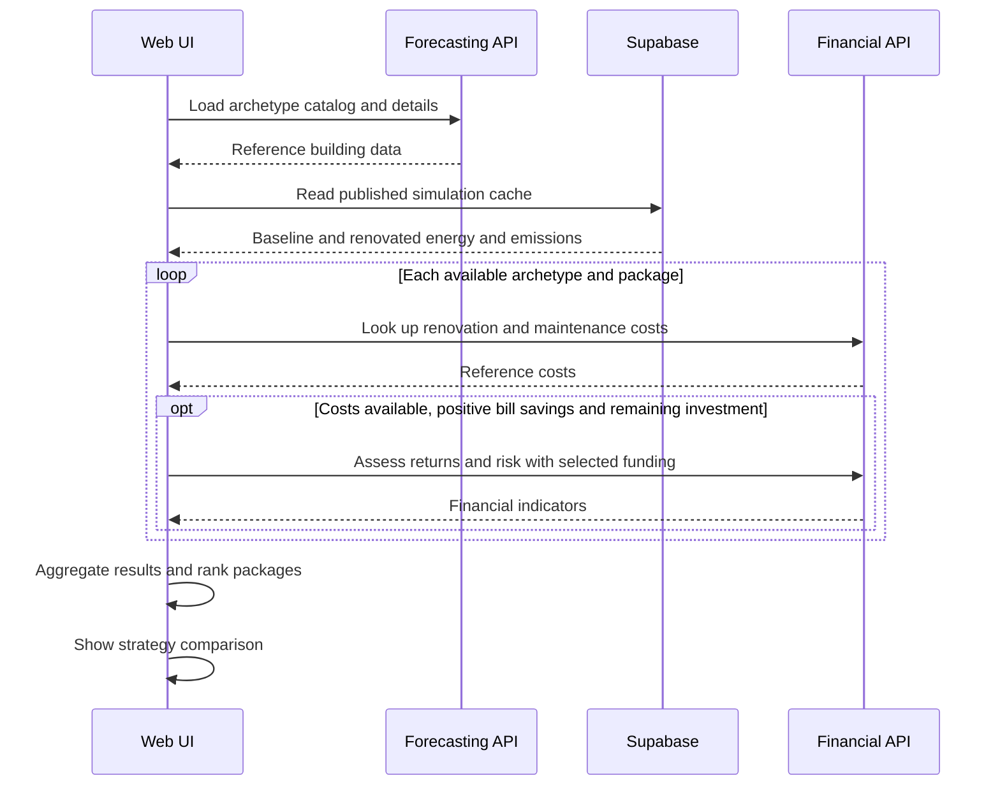

# ReLIFE Web Interface

Web interface for ReLIFE’s building-renovation tools, built with Vite, React, TypeScript, and Mantine UI.



## Development

The requirements are Node.js 22, Task, and Docker Compose.

Copy `.env.default` to `.env.local` and fill in the credentials.

```bash
npm ci           # Install dependencies
task dev         # Start Docker services and Vite with the API proxy
npm run build    # Build for production
npm run preview  # Preview the build
```

For local backend builds, `task fetch-sources` clones the three services into `external-services/`; `task dev-local` starts them with Vite.

### Testing

- `task test-unit`: Vitest unit and component tests, no backend required.
- `task test-e2e`: starts the locally built Docker stack and runs Playwright journeys for HRA and PRA. See [E2E prerequisites and commands](./tests/e2e/README.md).
- `task test`: both of the above.

### Releasing

Releases use SemVer tags (`vMAJOR.MINOR.PATCH`):

```bash
# Preview the next version and commands
task release -- patch --dry-run

# Bump the version, commit, tag, and push. Use minor or major for larger releases.
task release -- patch
```

The [release script](./scripts/release.sh) requires `main`, a clean working tree, and passing `task format-lint` checks. Pushing the release tag triggers the [Docker publish workflow](.github/workflows/docker-publish.yml) to publish the image to GHCR.

## Renovation Tool Workflows

### Home Renovation Assistant



### Portfolio Renovation Advisor



### Renovation Strategy Explorer


